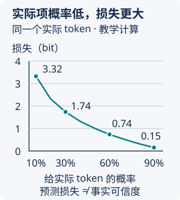

# 从训练到聊天助手：模型的能力是怎样来的

你把会议记录交给 AI，它能改写语气、整理行动项，甚至解释一段没见过的流程。可只要记录里缺少负责人，它又可能补出一个名字。

这两种表现来自同一套机制：**模型从许多数据中学到可复用的关系，再根据眼前的信息生成候选；能生成合适的表达，不代表每个事实都已经被核实。**

这一篇是可选的原理阅读。读过[模型怎样生成回答](03-模型如何生成回答.md)后，沿着“能力怎样学来 → 这次怎样使用 → 怎样变成助手”的顺序看即可。无需先掌握公式，也不必读完才能继续核心课。

## 30 秒判断

- 想知道“这些能力从哪里来”，看训练、参数和泛化；想知道“为什么这次这样答”，还要看本轮上下文和生成规则。
- 参数中的规律不附带逐条出处；执行搜索、读文件等动作，还需要外部程序与工具。
- 训练分数、表达偏好和事实证据回答不同问题，不能互相替代。

## 一、只预测下一步，为什么还能处理新问题

先看一组虚构的教学材料：

```text
主持人宣布会议结束，小陈把讨论整理成了一份____。
```

在这个位置，“纪要”比“蛋糕”更符合前文。要作出这种区别，模型不能只看最后两个字，还需要利用会议、讨论、整理和文件之间的关系。

换成“讨论结束后，请小陈记录决定和后续行动”，字词和顺序变了，任务却仍与纪要有关。一个只保存原句的查表程序可能找不到这句话；学到这些关系的模型则有机会把规律用于新表达。

**泛化**就是把学到的规律用于没见过的输入。它解释了为什么一个生成模型可以应对许多表达不同的任务，但不保证所有新问题都能做对。训练数据中的重复内容也可能被记住；记忆和泛化可以同时存在。

复杂回答也需要更多条件：长程推理是否稳定、材料是否足够、训练是否覆盖相近任务。预测任务能够推动模型学到有用的表示和能力，不能据此证明它已经拥有人的理解、意识或通用可靠性。

## 二、训练怎样知道这一轮预测好不好

假设训练文本中的实际下一个 token 是“纪要”。这里为便于演示，把“纪要”当作一个 token，实际编码可能拆成多个。下面两行是人为构造的概率，不是某个模型的测量结果：

| 对同一个实际 token 的预测 | 模型给“纪要”的概率 | 这一次应受到的纠正 |
|---|---:|---|
| 较符合这条训练文本 | 60% | 较小 |
| 很不符合这条训练文本 | 10% | 较大 |

训练需要一种分数，把“给实际出现的 token 多大概率”变成可优化的目标。常见的**交叉熵损失**就是这样一个分数：给实际 token 的概率越小，损失越大；对许多位置取平均，就能比较预测表现。

如果想核对计算，可用 `单个位置的损失 = -log₂(实际 token 的预测概率)`。上面的两个值分别约为 0.74 bit 和 3.32 bit。不计算公式，也能理解它为何更重地惩罚第二种预测。



图中比较的是**同一个实际 token**，所有点由上述公式计算，不是模型能力测量。概率从 60% 降到 10% 时，损失明显增大；曲线并不是“事实真实性随概率变化”的关系。

这里的“实际 token”来自训练文本，**不等于现实中的事实标准答案**。人写的文本可以含有错误、偏见和虚构；一个位置也可能有多种合理续写，只是数据里实际写了其中一种。所以损失降低说明模型在相应数据上预测更好，不能直接换算成“事实更真”或“这份工作可以交给它负责”。

**熵**描述概率分布本身的平均不确定性。公平硬币的正反面一样可能，比几乎总是正面的硬币更难预料。交叉熵则涉及模型怎样估计这个分布，两者不是同一个东西。真实语言的统计结果还取决于数据、上下文和分词方式，不能把某个研究中的数值当成所有语言模型的统一极限。

从规律看“压缩”也有帮助：保存一条可复用规则，通常比逐条保存所有例子简洁。但把数据压得短，不足以证明智能；这个视角更适合帮助理解学习，而不是替代能力评估。

## 三、损失怎样改变模型：参数、梯度和反向传播

模型内部有许多可调整的数字，叫**参数**。一个最简化的神经元，会先把输入乘上各自的权重再相加，再经过一次非线性变换。非线性让网络能够表达复杂关系；许多这样的计算连接、叠加起来，形成神经网络。

这里的“神经元”是计算单元的名称，不表示模型按人脑的方式思考。

先看一个只有一个参数的计算练习，**它不是完整语言模型**。程序算 `输出 = 参数 w × 2`，目标输出是 8；评分用“预测与目标的差的平方”。当 w 为 1，输出是 2，损失是 36。这里能直接算出：增加一点 w 会降低损失。

调整方向可以先用小变化理解：把 w 从 1 改成 1.01，输出从 2 变成 2.02，损失从 36 降到 35.7604。参数增加 0.01，损失约减少 0.24，变化率约为 -24。这个局部变化率就是**梯度**；实际训练通常用求导计算，不需要逐个试。

每次沿这个方向迈多大一步，由**学习率**控制。以固定学习率 0.0625 更新，得到下面几轮：

| 轮次 | 参数 w | 输出 | 与目标 8 的差 | 平方损失 |
|---|---:|---:|---:|---:|
| 初始 | 1 | 2 | -6 | 36 |
| 更新一次 | 2.5 | 5 | -3 | 9 |
| 更新两次 | 3.25 | 6.5 | -1.5 | 2.25 |
| 更新三次 | 3.625 | 7.25 | -0.75 | 0.5625 |

第一步怎样算？在 w 为 1 的位置，损失对 w 的梯度是 -24，于是 `新 w = 1 - 0.0625 × (-24) = 2.5`。第二轮再根据新位置计算梯度，继续调整。不是随便把数字改得越来越大，而是根据评分找到减少误差的方向；在别的例子里，也可能需要调小。

语言模型拥有大量参数，损失通常也不是这里的平方误差，但“先计算结果，再根据损失调整参数”的关系相通。你在聊天中要求再写一版，通常没有发生这张表中的参数更新。

训练的一轮可以这样理解：

1. **先预测。** 把一批训练文字交给网络，算出各位置的候选概率。
2. **再评分。** 对照实际出现的后续 token，计算损失。
3. **找调整方向。** 计算某个参数微小改变会怎样影响损失，这种变化率叫梯度。
4. **把影响传回各层。** 反向传播利用相连计算的关系，求出各参数的梯度。
5. **更新参数。** 优化器按梯度和步长调整参数，再处理下一批数据。

许多输入共用同一套参数。能帮助大量输入的调整，有机会被训练反复强化；只把少数例子记熟，也可能造成换材料后退化。训练并不保证找到最好的一组参数，更不保证每个任务都可靠。

这也解释了一个日常区别：你在聊天中说“负责人缺失时写待确认”，通常是在给本轮生成增加条件，并没有执行上面的参数更新。产品可以保存偏好，开发者也可以用授权数据做后续训练，但那是另一个过程。

## 四、Transformer 怎样使用一整段前文

token 是文字的编码单位，网络还需要把它转换成便于计算的一组数字，也就是向量。向量的维度通常不是人工命名的“会议程度”或“责任程度”；模型在训练中形成这些表示。

接下来，**注意力**让一个位置从可见的其他位置收集信息。例如在整理行动项时，“负责人”这个位置需要利用姓名、动作，以及“只是建议”“已经确认”等限定。

从计算职责看，注意力包含三种表示：

| 名称 | 在这一步负责什么 |
|---|---|
| 查询 Q | 当前这个位置用什么条件寻找信息 |
| 键 K | 其他位置用什么表示参与匹配 |
| 值 V | 匹配后实际汇入当前位置的信息 |

模型用查询和键计算匹配分数，把分数变成权重，再按权重汇集值。Q、K、V 由训练出的计算生成，不是系统给每句话手写的一张标签表。多组注意力可以同时利用不同关系，也不能把某组权重直接当成一份可靠的事实解释。

汇集信息以后，前馈网络继续加工各位置的表示；位置信息帮助模型区别先后顺序；残差连接保留并叠加中间表示，归一化帮助计算保持稳定。这些部件共同支撑多层计算，不能把全部能力归给“注意力”一个词。

可以沿着同一条教学输入追踪一次：

```text
“小陈把讨论整理成了一份”
  → 编码成 token，并换成数字表示
  → 各层从可见前文收集信息，再加工表示
  → 输出层得到候选 token 的分数
  → Softmax 把分数转换为总和为 1 的概率
  → 解码规则选出一个 token，接回前文
  → 继续生成，直到满足结束条件
```

这是常见自回归 Transformer 的简化说明，不是所有 AI 架构的统一规格。此处的因果注意力限制每个位置看见未来 token，是为了避免训练时偷看要预测的答案；“因果”这个名称不表示模型已经具备现实中的因果判断能力。

## 五、续写能力怎样变成助手行为

**预训练**让模型从大量数据中学到预测规律。得到的基座模型可能续写一串问题，也可能接出答案；它未必稳定扮演“回答你请求的助手”。后训练进一步改变这种行为。

| 训练方式 | 给模型什么反馈 | 希望改善什么 |
|---|---|---|
| 监督微调 SFT | 请求与合格回答的示范 | 按指令、角色和格式回应 |
| 偏好对齐 | 同一请求下哪些回答更合适的比较 | 回答的有用性、表达和行为边界 |
| 使用可验证奖励的训练 | 题目结果或执行结果能否通过检查 | 某些可检验任务的解决能力 |

偏好对齐有不同实现。典型 RLHF 流程先学习一个奖励模型，再用强化学习优化回答；DPO 等方法则可直接利用成对的偏好数据训练，不必照搬同一套流程。具体产品不一定使用表里的全部方法或相同顺序。

“更受偏好”不能替代“更有证据”。如果评分偏爱篇幅、肯定语气或迎合观点，模型也可能学到这些倾向。可验证奖励的作用同样受检查范围限制：程序通过几项测试，不代表所有情况都正确。

## 六、助手怎样读文件、搜索和执行动作

模型生成了“需要搜索资料”的动作请求，**外部运行程序**才会检查参数和权限，调用搜索工具，再把成功、失败或受阻结果送回模型。模型据此生成下一段回答或选择下一步。

例如，用户要求总结一份没有权限读取的文件：

```text
模型提出读取文件
  → 程序调用工具
  → 工具返回“无权访问”，没有正文
  → 下一轮模型得到失败结果
  → 应说明缺少材料，等待授权或用户提供内容
```

这时不能用语言能力“补出文件内容”。如果用户后来提供了可读取的文本，条件才发生改变：模型有了真实材料，才能基于它总结。一次受阻和一次成功，必须由实际工具结果区分。

把目标、状态、工具反馈、动态选择与停止规则组织起来，就进入了 [Agent Loop](../09-Agent与Harness工程/02-AgentLoop与状态推进.md)。它解决的是怎样推进任务，不是把生成概率变成事实保证。

多模态产品还可能把图像、音频等内容转换成模型能处理的表示。具体结构因模型而异；“图片也变成输入”不代表每个模型都能看图，更不代表它已经读取了某个附件。

## 七、参数更多，为什么仍要用真实任务检查

模型规模、训练数据、计算投入和后训练共同影响能力。扩大投入可能改善预测表现，但不是只加参数就能获得同等增长。数据质量、任务类型、推理时的计算和产品提供的工具，也会影响使用结果。

因此，两个推论都不成立：“大模型一定更适合我的工作”，以及“这道题做对了，所以它处理其他事情也可靠”。

回到会议任务，至少要换三种条件检查：记录明确、负责人缺失、先建议后否决。看看模型是否只在熟悉格式下答得好，还是能保留不同条件下的证据边界。这才把“它学到了规律”的原理问题，接回[轻量 Eval](../04-判断验证与风险/04-如何设计轻量Eval.md)中的实际判断。

面对下一条“AI 已经会了”的说法，先问：**它改了参数、改了本轮上下文，还是用了外部工具？它是在什么新材料、什么条件下被检查的？**

<!-- PRACTICE:START -->
### 可选反思：三种变化分别发生在哪里

看三个教学情境：你给本轮补了一个纪要示例；开发者用示范重新训练模型；搜索工具返回了一份新公告。分别判断它们改变了什么。

### 教学反馈

本轮示例改变上下文；重新训练更新参数；搜索取回新证据后，运行程序把它放入下一轮输入。若把三者都理解成“模型记住了”，就会误以为删除示例后行为仍然稳定，或以为没有调用搜索也能看到新公告。
<!-- PRACTICE:END -->
